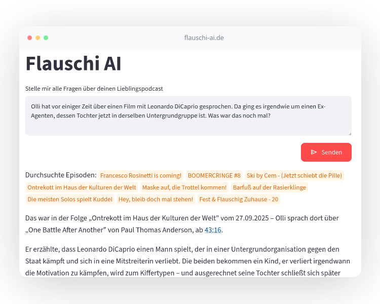

# Flauschi AI

[](https://flauschi-ai.de)

Ask questions about the German podcast **„Fest & Flauschig“** (Jan Böhmermann and Olli Schulz) and get answers with episode title, date and a timecode for every claim.

Flauschi AI is a retrieval-augmented generation (RAG) pipeline: it follows the podcast's RSS feed, transcribes new episodes with speaker labels, indexes the transcripts in a vector database and answers questions based only on the retrieved transcript excerpts.

> **Unofficial fan project**. Not affiliated with, endorsed by, or connected to the podcast or its makers. Transcripts and audio are copyrighted, so this repository contains neither. The pipeline builds your own index from the public RSS feed.

## Try it

**Live demo:** https://flauschi-ai.de

For example:

> Olli hat vor einiger Zeit über einen Film mit Leonardo DiCaprio gesprochen. Da ging es irgendwie um einen Ex-Agenten, dessen Tochter jetzt in derselben Untergrundgruppe ist. Was war das noch mal?

Questions that can be answered from a single relevant passage tend to work particularly well.

<p align="center">
  
</p>


## What it does

- **714+ episodes since 2016** are automatically transcribed and indexed for search.
- **Dagster pipeline:** RSS feed → audio archive → AssemblyAI transcription → structured transcript → vector database.
- **Speaker-aware chunking:** transcript chunks respect speaker turns and preserve **timestamps**.
- **Hybrid retrieval with Qdrant:** dense + sparse search, configurable `top_k`, optional date filtering.
- **RAG generation via OpenRouter:** answers are grounded exclusively in retrieved transcript excerpts.
- **Citations:** answers include episode, publication date, and transcript timecodes for cited claims.
- **Current limitation:** only the **top 10 retrieved passages** are given to the LLM, so focused questions work better than broad questions requiring information from many episodes.


## Project status

This is an **early but working MVP**.

The current system is already useful for many specific questions, but it is not intended to solve arbitrary questions about the complete podcast corpus.

Known limitations include:

- only the top retrieved passages are passed to the LLM
- broad questions requiring information from many episodes can fail
- there is no sophisticated multi-stage retrieval/reranking pipeline yet
- aggregated knowledge across the whole podcast is not yet modeled separately
- evaluation is still being developed

The project is intentionally evolving from a simple baseline toward more advanced retrieval and evaluation techniques.

## Data

The repository contains the application code, but **does not contain the podcast transcripts or audio recordings**.

The complete corpus used by the live application is generated and stored outside this repository. The public repository therefore contains the processing and retrieval pipeline, but not the copyrighted transcript corpus.

Podcast content is owned by its respective rights holders. Make sure that your use of downloaded audio and generated transcripts complies with applicable copyright law and the terms of the services involved.

## Running locally

### Requirements

 
- Python 3.10 – 3.14
- [`uv`](https://docs.astral.sh/uv/)
- Accounts / API keys, depending on what you want to run:

| Service | Needed for |
| --- | --- |
| [OpenRouter](https://openrouter.ai/) | Embeddings and answers (needed for every query) |
| [AssemblyAI](https://www.assemblyai.com/) | Transcription (pipeline only) |
| S3-compatible storage (e.g. Backblaze B2) | Audio archive (pipeline only) |
| [Qdrant](https://qdrant.tech/) (optional) | Remote vector store; by default a local store in `data/qdrant` is used |
| [Langfuse](https://langfuse.com/) (optional) | Tracing |
 
These services are paid or rate-limited but free trial accounts where available and $0.10 in OpenRouter (or free models - untested) should get you started with ~50 episodes.


### Install with uv

Install `uv` according to its [official documentation](https://docs.astral.sh/uv/getting-started/installation/).

Then:

```bash
uv sync
source .venv/bin/activate
```

### Configuration

Create a `.env` file based on `.env.example`.


## Usage
 
### 1. Run the pipeline (Dagster)
 
```bash
dg dev
```
 
Open <http://localhost:3000>. The `rss_feed_sensor` is enabled by default and starts processing the 10 newest episodes. All older episodes are registered as partitions as well. To process the back catalogue, materialize or backfill those partitions in the UI (watch your API costs, see above). You can also run individual assets and partitions by hand.
 
All intermediate results are written as JSON to `data/<asset>/<partition>.json`.
 
**Already have a `data/` directory?** Register the existing files as materializations so Dagster doesn't redo the work. Use the same `DAGSTER_HOME` as for `dg dev`:
 
```bash
python import_data.py
```
 
### 2. Index episodes manually (CLI)
 
The `vector_database` asset indexes new episodes automatically. For manual or bulk indexing from `data/episode/*.json`:
 
```bash
flauschi-ai ingest --pattern "^2026-0[89]"
```
 
`--pattern` is a regular expression matched against the file names (default: `2026.*`). Use `--pattern .` to index every episode.
 
 
### 3. Ask questions (CLI)
 
```bash
# Answer with sources
flauschi-ai rag "Was haben Jan und Olli über Elektroautos gesagt?"
 
# Only look at the retrieved chunks
flauschi-ai retrieve "Elektroautos"
``` 
 
| Option | Default | Description |
| --- | --- | --- |
| `--top_k` | `10` | Number of chunks to retrieve |
| `--published-after` | – | Only episodes on or after this date (`YYYY-MM-DD`) |
| `--published-before` | – | Only episodes on or before this date (`YYYY-MM-DD`) |


If you didn't activate the virtual environment, prefix the commands with `uv run`.
 
### 4. Web apps (Streamlit)
 
```bash
streamlit run src/flauschi_ai/ui/rag_app.py        # what you see at flauschi-ai.de
streamlit run src/flauschi_ai/ui/retrieval_app.py  # inspect retrieved chunks
```
 
Both need a populated vector store.
 


## License

The source code in this repository is licensed under the AGPL-3.0 License.

See [`LICENSE`](LICENSE).
